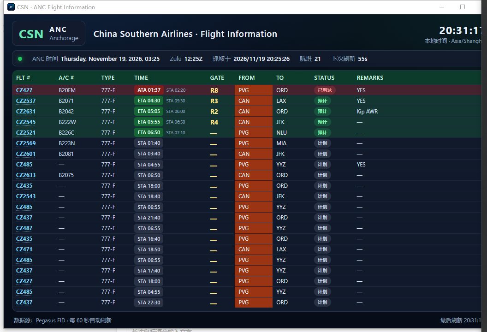

# CSN ANC 停机位与航班信息方案说明

版本：1.0　编制日期：2026-11-19　适用对象：后续维护/交接人员

## 1. 背景与目标

Pegasus FID 页面（`https://www.pegasusintranet.com/F/C/CSN/fid.php`）在国内网络环境下无法直连。本方案通过 GitHub Actions 的海外节点定时抓取 CSN 在 ANC（安克雷奇）的航班与停机位数据，发布到固定可读的地址，并配套一个本地 Windows 桌面看板。

核心目标：

- 每 5 分钟自动更新一次数据，无需人工干预
- 国内可直接读取固定 URL，不依赖任何本地服务器
- 数据包含航班号、机号、机型、机位、起降站、计划/预计/实际时刻、备注等
- 提供桌面看板，便于值班人员查看

## 2. 总体架构

```
cron-job.org（每 5 分钟）
        │  POST workflow_dispatch（带 PAT）
        ▼
GitHub Actions（海外 runner）
        │  抓取页面 + POST ajaxgetflights.php
        ▼
GitHub Gist（覆盖写入 latest.json / latest.csv / raw.html / status.json）
        │  gist.githubusercontent.com（国内通常可达）
        ▼
桌面看板（MYGO + Vue 3）/ 其他业务系统
```

| 组件 | 位置 | 作用 |
| --- | --- | --- |
| GitHub 仓库 | `honghebincsg/pegasus-fid-gist`（public） | 存放 workflow 与抓取脚本 |
| GitHub Actions | 仓库 Actions | 海外节点执行抓取 |
| GitHub Gist | `honghebincsg/0f820895dffee67ecf897420e1e430cb` | 存储最新数据 |
| cron-job.org | 账户 `honghebincsg` 名下任务 | 每 5 分钟触发 workflow |
| 桌面看板 | 本地 `desktop/anc-fid.exe` | 展示航班与停机位 |

## 3. 数据来源

页面本身是 JavaScript 空壳，航班数据由页面脚本请求以下接口获得：

- 页面：`https://www.pegasusintranet.com/F/C/CSN/fid.php`（页面每 120 秒自动刷新）
- 接口：`POST https://www.pegasusintranet.com/F/C/ajaxgetflights.php`
- 参数：`fid=CSN`、`cust=CSN`（表单提交）
- 响应格式：`OK|<JSON 数组>|<通告>`；无航班时为 `OK|none|...`，无通告为 `None`
- 编码：UTF-8（脚本兼容 GB18030）

主要字段：

| 字段 | 含义 | 字段 | 含义 |
| --- | --- | --- | --- |
| FlightNumber | 航班号 | RegistrationNumber | 注册号 |
| ACType | 机型 | GateNumber | 机位 |
| FromStation / ToStation | 始发 / 目的站 | STA / STD | 计划到达 / 离港 |
| ETA / ETD | 预计到达 / 离港 | ATA / ATD | 实际到达 / 离港 |
| LSODate | 任务单日期 | Delay / DelayReason | 延误 / 原因 |
| Comments_MX / FO / GH / PS | 机务 / 机组 / 地面 / 客运备注 | AOG | 不适航标志 |
| LongTurn | 长停标志 | International | 国际航班标志 |
| Inbound/OutboundCrew | 进出港机组 | Inbound/OutboundCargo | 进出港货物 |
| MxControl / AWR / DeicebyPMX | 机务控制 / AWR / 除冰 | PaperWorkStatus | 单据状态 |

接口返回字段约 150 个，脚本完整保留在 `fid_latest.json` 中，桌面详情弹框按分组展示。

## 4. 定时抓取

- 脚本：`scripts/fetch_fid.py`
- Workflow：`.github/workflows/fetch-fid.yml`
- 触发方式：
  - 主：cron-job.org 每 5 分钟调用 `workflow_dispatch`
  - 兜底：workflow 内置 `cron: "*/5 * * * *"`（GitHub 自带调度可能延迟或跳过）
- 运行步骤：checkout → Python 3.12 → 安装依赖 → 执行脚本 → 上传 artifact（保留 3 天）
- 成功时：覆盖更新 Gist 的 `fid_latest.json`、`fid_flights.csv`、`fid_raw.html`、`fid_status.json`
- 失败时：只更新 `fid_status.json` 标记失败，旧航班数据保留
- 运行耗时：约 20 秒；public 仓库标准 runner 免费

## 5. 存储与读取

Gist 文件：

| 文件 | 内容 |
| --- | --- |
| `fid_latest.json` | 航班数组、通告、页面时间、抓取时间、接口地址 |
| `fid_flights.csv` | 同一份数据的 CSV，便于表格/程序读取 |
| `fid_raw.html` | 页面原始 HTML（排障用） |
| `fid_status.json` | 最近一次抓取状态、航班数、错误信息 |

国内读取地址（固定不变，永远返回最新）：

```text
JSON：https://gist.githubusercontent.com/honghebincsg/0f820895dffee67ecf897420e1e430cb/raw/fid_latest.json
CSV ：https://gist.githubusercontent.com/honghebincsg/0f820895dffee67ecf897420e1e430cb/raw/fid_flights.csv
状态：https://gist.githubusercontent.com/honghebincsg/0f820895dffee67ecf897420e1e430cb/raw/fid_status.json
```

注意事项：

- `gist.github.com` 国内通常打不开，读取请用 `gist.githubusercontent.com`
- raw 响应有 `Cache-Control: max-age=300`，刚更新后可能读到 5 分钟内的旧版；程序读取可加 `?t=<时间戳>` 绕过
- 每次更新会在 Gist 生成一个版本记录，只影响网页历史，不影响读取
- Gist 为 secret（不出现在搜索），但持有链接即可读取，不要放入敏感信息

## 6. 桌面看板



- 技术：MYGO（Go 桌面框架，WebView2）+ Vue 3（bootcdn CDN，staticfile 兜底）
- 程序：`desktop/anc-fid.exe`（约 11 MB，双击运行）
- 功能：
  - 航班表：航班号、机号、机型、时间（ATA/ETA/STA）、机位、起降站、状态、备注
  - 颜色规则沿用原 FID 页面：绿=预计、深红=已到达、红=AOG、橙=国际、黄=长停备注
  - 点击航班号弹出详情，按“概览 / 时刻 / 备注与工作 / 已启用服务 / 机组与货物 / 人员与联络 / 单据与记录 / 其他字段”分组展示
  - 每 60 秒刷新 Gist 数据；失败自动重试并亮红灯，旧数据保留
- 环境要求：Windows 10+、WebView2 Runtime（Win11 自带）
- 构建：

```sh
cd desktop
go-winres make
go build -ldflags="-H windowsgui" -o anc-fid.exe .
```

- 需要 Go 1.27+（首次构建建议 `set GOPROXY=https://goproxy.cn,direct`）
- 图标与文件属性在 `desktop/winres/winres.json` 中维护（文件说明、产品名、版本 1.0.0.0、公司/作者、版权、构建日期）

目录结构：

```
desktop/
├── main.go              MYGO 窗口与图标
├── frontend/index.html  Vue 3 看板与详情弹框
├── winres/              图标与版本资源
├── go.mod / go.sum
└── anc-fid.exe          编译产物
```

## 7. 配置与凭据

仓库 secrets：

| 名称 | 用途 | 说明 |
| --- | --- | --- |
| `FID_GIST_TOKEN` | 写 Gist | classic PAT 勾选 `gist` |
| `FID_GIST_ID` | 目标 Gist | `0f820895dffee67ecf897420e1e430cb` |

cron-job.org 任务：

- 名称：`Trigger FID fetch`
- URL：`https://api.github.com/repos/honghebincsg/pegasus-fid-gist/actions/workflows/fetch-fid.yml/dispatches`
- 方法：POST
- Headers：`Authorization: Bearer <PAT>`、`Accept: application/vnd.github+json`、`X-GitHub-Api-Version: 2022-11-28`、`Content-Type: application/json`
- Body：`{"ref":"main"}`
- 频率：每 5 分钟；时区 Asia/Shanghai
- Token：fine-grained PAT，仅授权该仓库、**Actions: Read and write**，永久有效

交接清单（凭据不写入本文档）：

1. GitHub 账号 `honghebincsg` 的仓库与 secrets 访问权
2. Gist 链接（本方案第 5 节）与 secret 中的 Gist token
3. cron-job.org 账号及任务编辑权
4. cron-job.org 中使用的 fine-grained PAT（如需换人，建议撤销旧 token 后重新生成，并在 cron-job.org 更新 Header）
5. 本地桌面程序与源码（`desktop/`）

## 8. 运维与排障

| 现象 | 原因与处理 |
| --- | --- |
| cron-job HISTORY 显示 403 | PAT 缺 Actions 写权限；重新生成 fine-grained token，选 Actions: Read and write |
| Gist 创建/更新 404 | Gist token 缺 `gist` 权限 |
| `gist.github.com` 打不开 | 国内网络限制；改用 `gistusercontent.com` raw 地址 |
| raw 读到旧数据 | CDN 缓存 5 分钟；加 `?t=` 时间戳 |
| GitHub schedule 不触发 | 新仓库或修改 cron 后的延迟；以 cron-job.org 为准 |
| 5 分钟档突然停跑 | 私有仓库免费分钟耗尽；本仓库为 public，不受影响 |
| Actions 报接口解析错误 | 目标站页面/接口结构变化；下载 artifact 的 `fid_raw.html` 排查 |
| 中文乱码 | 编码探测顺序 UTF-8 → GB18030，已内置 |
| artifact 下载 401 | 重定向后不能带 Authorization；用 API 取 Location 后匿名下载 |
| 桌面灯红 | 数据超过 30 分钟未更新或抓取失败；看 `fid_status.json` |

常用调整：

- 改频率：cron-job.org 任务调度 + workflow 内 cron（建议保持一致）
- 改目标站：修改 `scripts/fetch_fid.py` 的 `DEFAULT_URL` 与 `FID_CODE`
- 改展示字段：`desktop/frontend/index.html` 中的 `DETAIL_GROUPS` 与 `LABELS`

## 9. 变更记录

| 日期 | 版本 | 内容 |
| --- | --- | --- |
| 2026-11-19 | 1.0 | 首版：Actions 抓取、Gist 存储、cron-job.org 5 分钟触发、桌面看板、图标与版本属性 |

---

维护建议：交接后先在 cron-job.org 的任务 HISTORY 和 GitHub Actions 各确认一次运行记录，再修改任何配置；修改 PAT 时先新增、验证成功后再撤销旧 token，避免定时中断。
